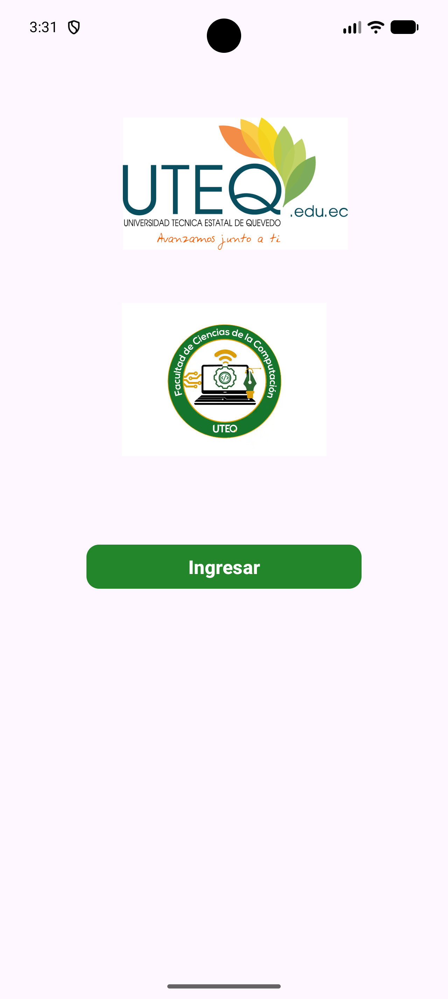
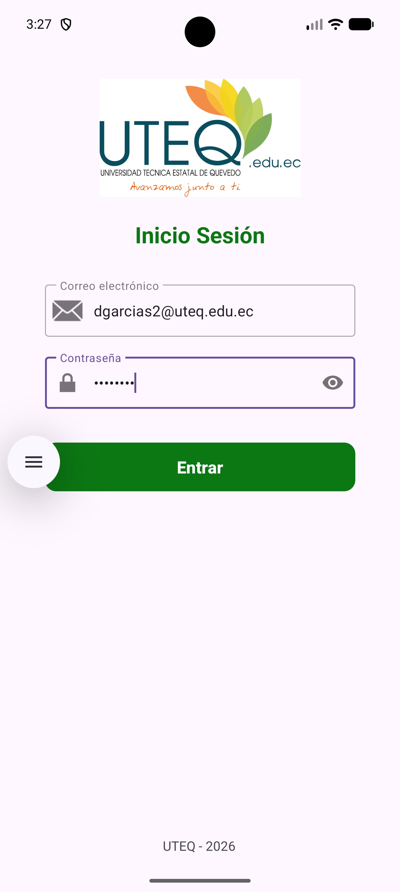

# Actividad en clases - Bienvenida e Inicio de Sesión

Aplicación Android desarrollada en **Java** que contiene dos pantallas con la identidad de la **UTEQ**: una pantalla de **bienvenida** y una pantalla de **inicio de sesión**. Ambas están diseñadas con `ConstraintLayout` y componentes de **Material Design**.

  
  &nbsp;&nbsp;&nbsp;
  

## Pantallas

### 1. Bienvenida (`MainActivity`)
Archivo de diseño: `activity_main.xml`

| Elemento | Componente | Descripción |
|---|---|---|
| Logo de la universidad | `ImageView` | Imagen `logo_universidad` en la parte superior |
| Logo de la facultad | `ImageView` | Imagen `logo_facultad_fcc` debajo del logo principal |
| Ingresar | `MaterialButton` | Botón verde (`#0B7813`) con bordes redondeados |
| Pie de página | `TextView` | Texto "UTEQ - 2026" en la parte inferior |

### 2. Inicio de sesión (`inicioseccion`)
Archivo de diseño: `activity_inicioseccion.xml`

| Elemento | Componente | Descripción |
|---|---|---|
| Logo de la universidad | `ImageView` | Imagen `logo_universidad` |
| Título | `TextView` | "Inicio Sesión" en verde y negrita |
| Correo electrónico | `TextInputLayout` + `TextInputEditText` | Estilo *Outlined*, icono de correo y teclado de email |
| Contraseña | `TextInputLayout` + `TextInputEditText` | Estilo *Outlined*, icono de candado y botón de ojo para mostrar u ocultar la contraseña |
| Entrar | `MaterialButton` | Botón verde con bordes redondeados |
| Pie de página | `TextView` | Texto "UTEQ - 2026" |

## Detalles técnicos

- **Lenguaje:** Java
- **Layout principal:** `ConstraintLayout`, que posiciona cada elemento en relación con los demás y con los bordes de la pantalla.
- **Componentes Material Design:**
  - `MaterialButton` con `app:cornerRadius` y `app:backgroundTint` para los botones.
  - `TextInputLayout` con estilo `OutlinedBox`, `app:startIconDrawable` para los iconos y `app:passwordToggleEnabled` para la contraseña.
- **Tipos de entrada:** `textEmailAddress` para el correo y `textPassword` para la contraseña.
- **Imágenes:** `logo_universidad.png` y `logo_facultad_fcc.png` en `res/drawable`.
- **Pantalla de inicio:** se define en el `AndroidManifest.xml` mediante el `intent-filter` con `MAIN` y `LAUNCHER`.
- **SDK:** mínimo 28 (Android 9), objetivo 37.

